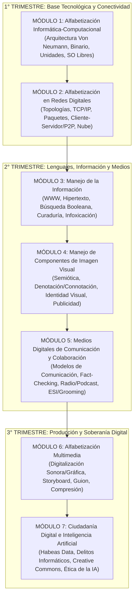

# INVESTIGACIÓN EXHAUSTIVA DE FUENTES Y RECURSOS DIDÁCTICOS INTERNACIONALES PARA NTICx
**Nivel Educativo:** 4.º Año - Ciclo Superior de Educación Secundaria (Provincia de Buenos Aires)  
**Marco Oficial:** Diseño Curricular NTICx (DGCyE PBA, 2010 - 72 horas anuales / 2 h semanales)  
**Fecha de Verificación Documental:** Noviembre de 2026  
**Enfoque:** Doble Vía Pedagógica — Modalidad Desenchufada (*Computer Science Unplugged*) y Modalidad Digital (Online/Local)

---

## 1. MARCO CURRICULAR PRESCRIPTIVO DE NTICx (DGCyE PBA)

El Diseño Curricular de **Nuevas Tecnologías de la Información y la Conectividad (NTICx)** se estructura bajo el paradigma de la **Alfabetización Digital-Informacional (ADI)**. No concibe la tecnología como mera capacitación instrumental en software específico, sino como un campo de saberes atravesado por tres dimensiones interdependientes: **técnica-computacional**, **comunicativa-mediática** y **ética-social**.

A diferencia de otros planes de estudio internacionales que dividen la computación del diseño o la sociología de medios, el currículum bonaerense organiza la materia en **siete módulos articulados**:

---

## 2. METODOLOGÍA DEL RELEVAMIENTO TRANSNACIONAL

Para evitar la importación acrítica de recursos que no se adapten a la realidad de la escuela secundaria argentina (donde conviven la falta o intermitencia de Internet, equipos heterogéneos y normativas locales de convivencia), se establecieron los siguientes **criterios de selección**:
1. **Acceso Abierto (OER / REA):** Recursos libres de costo, sin barreras comerciales ni registros obligatorios complejos que excluyan a los alumnos.
2. **Pertinencia Etaria:** Materiales diseñados o adaptables para jóvenes de **14 a 16 años** (equivalentes a 4.º año bonaerense, 3.º/4.º ESO en España, 1.º/2.º Medio en Chile, Key Stage 4 en Reino Unido, Years 9–10 en Australia y Grades 9–10 en EE. UU.).
3. **Perspectiva Dual (Offline/Online):** Toda unidad técnica cuenta con alternativas desenchufadas (*unplugged*) en papel/aula y prácticas en software libre local (Huayra/Linux, GIMP, Audacity, LibreOffice) para funcionar sin conexión.
4. **Respeto a la Soberanía Legal:** Las referencias a leyes extranjeras (de privacidad o ciberdelito) se toman como contraste analítico, manteniendo siempre en el centro el marco jurídico argentino (Ley 25.326 de Protección de Datos Personales, Ley 26.388 de Delitos Informáticos y Ley 27.590 de Prevención del Grooming).

---

## 3. CATÁLOGO EXHAUSTIVO DE FUENTES POR MÓDULO: METADATOS Y ACTIVIDADES DUALES

A continuación se detalla la matriz de correspondencia unidad por unidad con enlaces directos verificados, metadatos operativos y propuestas didácticas diferenciadas para modalidades **Offline** y **Online**:

---

### 💻 MÓDULO 1: Alfabetización Informática-Computacional
* **Núcleos de Contenido:** Técnica vs. tecnología e innovación; Von Neumann (CPU, ALU, UC, memorias RAM/ROM, buses, periféricos); ciclo de instrucción; sistema binario y código ASCII; unidades de medida (bit a TB); sistemas operativos propietarios vs. libres (GNU/Linux - Huayra); software de ofimática (procesador de textos y planillas de cálculo); virus y malware.

| Recurso y Enlace Directo | Organismo / País | Nivel e Idioma | Requisitos de Aula y Licencia |
| :--- | :--- | :--- | :--- |
| [CS Unplugged: Binary Numbers](https://csunplugged.org/en/topics/binary-numbers/) | Universidad de Canterbury (Nueva Zelanda) | 12–16 años · Inglés (traducción libre) | Material imprimible / Cartulina. Licencia CC BY-NC-SA 4.0. |
| [Teach Computing: Computer Systems (KS4)](https://teachcomputing.org/curriculum/key-stage-4/computer-systems) | NCCE / Raspberry Pi Foundation (Reino Unido) | 14–16 años (KS4) · Inglés | Visualización web / Guías DOCX. Acceso gratuito. |
| [Digital Technologies Hub: Data Representation](https://www.digitaltechnologieshub.edu.au/teach-and-assess/classroom-resources/topics/data-representation/) | Education Services Australia | Years 9–10 · Inglés | Descarga PDF. Licencia CC BY 4.0. |
| [Filosofía del Software Libre (GNU)](https://www.gnu.org/philosophy/free-sw.es.html) | Free Software Foundation (EE. UU.) | Superior · Español | Lectura web / Texto local. Licencia libre. |

#### Actividades Pedagógicas Duales:
* **Vía A - Desenchufada (Offline):**  
  * *La Computadora Humana (Dinámica de roles Sadosky / CS Unplugged):* Se asignan roles en el aula (1 alumno UC, 1 ALU, casilleros de RAM y buses de papel). Se simula físicamente una instrucción de suma paso a paso.
  * *Tarjetas Binarias:* Cada estudiante recibe 5 tarjetas con puntos (16, 8, 4, 2, 1). Se enseña a prender/apagar bits para formar números y decodificar mensajes cifrados en ASCII sobre la carpeta.
* **Vía B - Laboratorio Digital (Online / Local):**  
  * *Auditoría de Almacenamiento:* Usando LibreOffice Calc y el explorador de archivos de Huayra/Windows, los alumnos registran los tamaños reales en bytes de diferentes formatos (.txt, .jpg, .wav, .iso) y construyen una tabla de conversión matemática.

---

### 🌐 MÓDULO 2: Alfabetización en Redes Digitales de Información
* **Núcleos de Contenido:** Concepto de red; medios guiados (UTP, fibra óptica) y no guiados (WiFi, satelital); coberturas PAN, LAN, MAN, WAN; topologías físicas (bus, estrella, anillo, malla); arquitectura TCP/IP; direccionamiento IP y DNS; paquetes de datos y enrutamiento; modelos cliente-servidor vs. P2P; computación en la nube (*Cloud Computing*).

| Recurso y Enlace Directo | Organismo / País | Nivel e Idioma | Requisitos de Aula y Licencia |
| :--- | :--- | :--- | :--- |
| [Code.org: CSP Unit 2 - The Internet](https://studio.code.org/courses/csp-2025/units/2?viewAs=Instructor) | Code.org (EE. UU. / Global) | 14–18 años · ES / EN | Simulador interactivo en línea (*Internet Simulator*). Gratuito. |
| [PortalESO: Unidad Didáctica Redes 4º ESO (PDF)](http://www.portaleso.com/Redes/Ud_4_redes_V1_c.pdf) | PortalESO (España) | 15–16 años (4º ESO) · Español | Descarga PDF / Imprimible. Gratuito para uso educativo. |
| [Eduscol: Fiche Routage et Calculs d'Itinéraires (PDF)](https://eduscol.education.gouv.fr/sites/default/files/document/ra19lyceegsnt2ndroutagecalculsitineraires1150596pdf-83100.pdf) | Ministère de l'Éducation Nationale (Francia) | 15–16 años (Seconde SNT) · Francés | Ficha teórica / Grafos. Dominio público institucional. |
| [Teach Computing: Computer Networks (KS4)](https://teachcomputing.org/curriculum/key-stage-4) | NCCE (Reino Unido) | 14–16 años · Inglés | Guías y diagramas de red. Software opcional (Packet Tracer). |

#### Actividades Pedagógicas Duales:
* **Vía A - Desenchufada (Offline):**  
  * *Simulación de Enrutamiento con Ovillos de Lana:* El curso se distribuye formando una red con topología de malla. Se envían "paquetes de cartas" con dirección IP de origen y destino. Ante el corte simulado de un enlace ("se cayó un cable"), los nodos intermedios deben recalcular la ruta alternativa en su tabla de ruteo en papel.
* **Vía B - Laboratorio Digital (Online / Local):**  
  * *Exploración de Red por Consola:* Ejecución en la terminal de comandos locales de diagnóstico (`ping`, `traceroute` o `tracert`, `ipconfig` / `ip addr`) para visualizar el salto entre routers y la resolución de nombres DNS.

---

### 🔍 MÓDULO 3: Alfabetización en Manejo de la Información
* **Núcleos de Contenido:** Digitalización y estructura de la World Wide Web; hipertexto, hipervínculos, protocolo HTTP y URLs; lenguaje HTML; motores de búsqueda y metabuscadores; operadores booleanos (AND, OR, NOT, comillas, filetype); metodología de investigación y curaduría de contenidos; infoxicación y sobrecarga informativa; evolución de la Web (Web 1.0 a 4.0); sociedad del conocimiento.

| Recurso y Enlace Directo | Organismo / País | Nivel e Idioma | Requisitos de Aula y Licencia |
| :--- | :--- | :--- | :--- |
| [Eduteka: Guía del Modelo Gavilán (PDF)](https://eduteka.icesi.edu.co/pdfdir/GuiaGavilan.pdf) | Universidad ICESI (Colombia) | 13–17 años · Español | Lectura PDF / Fichas de análisis imprimibles. Gratuito. |
| [UNESCO: Currículum AMI - Think Critically, Click Wisely!](https://unesdoc.unesco.org/ark:/48223/pf0000377068) | UNESCO (Internacional) | Formación Docente / Media · ES / EN | Documento PDF descargable. Licencia abierta UNESCO. |
| [Digital Technologies Hub: Webpage Design (Years 9–10)](https://www.digitaltechnologieshub.edu.au/search/years-9-10-webpage-design/) | Education Services Australia | Years 9–10 · Inglés | Editor de texto plano y navegador. CC BY 4.0. |
| [Common Sense Education: How to SIFT with AI](https://www.commonsense.org/education/digital-citizenship) | Common Sense (EE. UU.) | Grades 9–12 · Inglés | Proyector / Discusión en aula. Gratuito (sin derivados). |

#### Actividades Pedagógicas Duales:
* **Vía A - Desenchufada (Offline):**  
  * *Taller de Curaduría en 4 Pasos (Modelo Gavilán):* Se entrega a los equipos un legajo con recortes de prensa impresos, folletos y artículos contradictorios sobre un tema local. Deben completar una matriz de validación en papel evaluando autoría, fecha, intencionalidad y contraste cruzado de fuentes.
* **Vía B - Laboratorio Digital (Online / Local):**  
  * *Laboratorio de Operadores Booleanos:* Búsqueda guiada en motores de búsqueda utilizando operadores avanzados (`site:gov.ar "educación secundaria" filetype:pdf -universidad`) y comparación inmediata con respuestas arrojadas por asistentes de IA generativa para detectar alucinaciones.

---

### 👁️ MÓDULO 4: Alfabetización en Manejo de Componentes de Imagen Visual
* **Núcleos de Contenido:** La imagen como mensaje; lenguaje visual y cultura icónica; signos, símbolos e iconos; niveles de lectura semiótica: denotación (lo explícito) y connotación (lo implícito/sugerido); identidad visual institucional y corporativa: logotipo, isotipo, imagotipo e isologo; retórica publicitaria (metáfora, hipérbole, elipsis); psicología del color; mapas de bits vs. vectores; edición gráfica en software libre (GIMP / Inkscape).

| Recurso y Enlace Directo | Organismo / País | Nivel e Idioma | Requisitos de Aula y Licencia |
| :--- | :--- | :--- | :--- |
| [INTEF: GIMP - Edita tus imágenes de forma gratuita (PDF)](https://intef.es/wp-content/uploads/2022/10/Gimp.pdf) | INTEF (España) | Secundaria / Bachillerato · Español | Software libre GIMP (instalable localmente). CC BY-SA 4.0. |
| [CS Unplugged: Image Representation (PDF)](https://classic.csunplugged.org/wp-content/uploads/2014/12/unplugged-02-image_representation.pdf) | Universidad de Canterbury (Nueva Zelanda) | 12–16 años · Inglés / Español | Hojas cuadriculadas impresas. Licencia CC BY-NC-SA 4.0. |
| [UNESCO AMI: Module 6 - Representation in Media and Information](https://www.unesco.org/mil4teachers/en/module6) | UNESCO (Internacional) | Docentes y estudiantes · Inglés | Análisis de casos / Debate visual. Acceso abierto. |
| [Teach Computing: Creating Digital Graphics (KS4)](https://teachcomputing.org/curriculum/key-stage-3/media/creating-digital-graphics) | NCCE (Reino Unido) | 14–16 años · Inglés | Software de mapa de bits y vectorial. Gratuito. |

#### Actividades Pedagógicas Duales:
* **Vía A - Desenchufada (Offline):**  
  * *Deconstrucción Semiótica en Afiches:* En grupos de 4, analizan publicidades gráficas de revistas recortadas. En una ficha técnica a dos columnas, describen: a la izquierda lo denotativo (colores exactos, planos, tipografía), a la derecha lo connotativo (aspiraciones, roles de género, promesas de estatus).
  * *Kid Fax / Pixel Grids:* Dibujo de imágenes en blanco y negro mediante cadenas de números binarios en papel cuadriculado milimetrado.
* **Vía B - Laboratorio Digital (Online / Local):**  
  * *Diseño de Identidad Visual con GIMP/Inkscape:* Creación de una marca institucional propia (para un club o centro de estudiantes) aplicando tipografía, capas, canales alfa de transparencia y justificación técnica de isotipo o imagotipo.

---

### 📣 MÓDULO 5: Alfabetización en Medios Digitales de Comunicación y Colaboración
* **Núcleos de Contenido:** Modelos de comunicación digital (Shannon-Weaver revisitado); medios masivos vs. redes horizontales; periodismo digital; trabajo colaborativo mediante tableros ágiles; verificación de desinformación (*fact-checking*); **Efemérides ESI y Derechos:** algoritmos de recomendación, filtros de belleza y mandatos estéticos; prevención del ciberacoso y *Grooming* (Ley Nacional 27.590 "Mica Ortega").

| Recurso y Enlace Directo | Organismo / País | Nivel e Idioma | Requisitos de Aula y Licencia |
| :--- | :--- | :--- | :--- |
| [Proyecto EDIA: REA Radio Exploradores (Guía Didáctica)](https://descargas.intef.es/cedec/proyectoedia/realengua/contenidos/radioexploradores/gua_didctica.html) | CEDEC / INTEF (España) | 13–16 años · Español | REA en eXeLearning / HTML descargable. Licencia CC BY-SA 4.0. |
| [Ceibal: Un juego que no es un juego - Violencia escolar y redes](https://rea.ceibal.edu.uy/elp/un-juego-que-no-es-un-juego-violencia-escolar-y-redes-sociales/autoevaluacin.html) | Plan Ceibal (Uruguay) | Educación Media · Español | Navegador web o recurso exportado. Licencia libre Ceibal. |
| [Common Sense Education: Chatting and Red Flags](https://www.commonsense.org/education/digital-citizenship/lesson/chatting-and-red-flags) | Common Sense (EE. UU.) | Grades 9–12 · Inglés / Español | Guía de discusión y videos. Gratuito. |
| [Proyecto EDIA: REA «Dale Corriente» - Tableros Kanban](https://cedec.intef.es/proyecto-edia-rea-dale-corriente-para-tecnologia-y-digitalizacion-de-2o-3o-eso/) | CEDEC / INTEF (España) | 13–15 años · Español | Plantillas ODT/PDF editables. CC BY-SA 4.0. |

#### Actividades Pedagógicas Duales:
* **Vía A - Desenchufada (Offline):**  
  * *Taller ESI sobre Grooming y Ley Mica Ortega:* Dramatización de roles y análisis de capturas de chats impresas y anonimizadas. Los alumnos identifican las fases del engaño (acercamiento, aislamiento, amenaza) y redactan en afiches un decálogo de actuación y canales de denuncia legal en Argentina (Línea 102 / 137).
  * *Tablero Kanban en Pizarrón:* Gestión de un proyecto editorial grupal utilizando notas adhesivas (*post-its*) clasificadas en: *Por hacer, En progreso, En revisión, Hecho*.
* **Vía B - Laboratorio Digital (Online / Local):**  
  * *Fact-Checking y Búsqueda Inversa:* Taller práctico con herramientas web gratuitas (Google Lens, TinEye, InVID) para verificar si una foto viralizada pertenece a un conflicto real o es una pieza descontextualizada.

---

### 🎬 MÓDULO 6: Alfabetización Multimedia
* **Núcleos de Contenido:** Lenguaje multimedia e hipermedia; interactividad; digitalización y muestreo del sonido (ondas sonoras, frecuencia en Hz, bit rate); compresión de datos con y sin pérdida (lossy / lossless); formatos (.mp3, .wav, .mp4, .mkv, .png); lenguaje cinematográfico: tipos de planos, ángulos y movimientos de cámara; guion técnico a dos columnas; diseño de *Storyboard*; montaje de video; herramientas de autor (eXeLearning).

| Recurso y Enlace Directo | Organismo / País | Nivel e Idioma | Requisitos de Aula y Licencia |
| :--- | :--- | :--- | :--- |
| [Teach Computing: Representations - Going Audiovisual (KS3)](https://teachcomputing.org/curriculum/key-stage-3/representations-going-audiovisual) | NCCE (Reino Unido) | 13–15 años · Inglés | Software Audacity y GIMP (locales). Gratuito. |
| [BFI Education: Visual Storytelling & Shot Types Guide](https://www.bfi.org.uk/education-research) | British Film Institute (Reino Unido) | 14–18 años · Inglés | Tarjetas de planos y plantillas de Storyboard PDF. Gratuito. |
| [Software Libre eXeLearning (Proyecto EDIA)](https://cedec.intef.es/proyecto-edia/) | CEDEC / INTEF (España) | Todas las etapas · Multiidioma | Software libre multiplataforma. Licencia GPL. |
| [Teach Computing: Media - Animations](https://teachcomputing.org/curriculum/key-stage-3/media-animations) | NCCE (Reino Unido) | 13–14 años · Inglés | Editor de animación / Blender o 2D libre. Gratuito. |

#### Actividades Pedagógicas Duales:
* **Vía A - Desenchufada (Offline):**  
  * *Storyboard y Guion a Dos Columnas:* Cada equipo diseña a mano una secuencia de 6 a 9 viñetas para un spot escolar contra la violencia digital. Dibujan el encuadre (Plano Detalle, Plano Medio, Plano General) e indican en columnas separadas la acción visual y la banda sonora (locución, efectos de sonido y cortina musical).
* **Vía B - Laboratorio Digital (Online / Local):**  
  * *Edición y Muestreo con Audacity:* Grabación de locuciones con netbooks o celulares escolares, importación de pistas a Audacity, ecualización, eliminación de ruido de fondo, inserción de efectos sonoros libres y exportación comprimida a .mp3 a diferentes tasas de bits (64 kbps vs. 320 kbps) para comparar calidad auditiva y peso en MB.

---

### ⚖️ MÓDULO 7: Alfabetización en Ciudadanía Digital e Inteligencia Artificial
* **Núcleos de Contenido:** Identidad digital, huella y reputación online; soberanía sobre los datos personales; legislación argentina: Ley 25.326 de Protección de Datos Personales (Habeas Data) y Ley 26.388 de Delitos Informáticos; propiedad intelectual en la era digital: Copyright, Copyleft, dominio público y licencias Creative Commons; ciberseguridad básica y *Hacking Ético* (sombreros blancos vs. negros); Inteligencia Artificial generativa: modelos de lenguaje, sesgos algorítmicos, deepfakes y principios éticos.

| Recurso y Enlace Directo | Organismo / País | Nivel e Idioma | Requisitos de Aula y Licencia |
| :--- | :--- | :--- | :--- |
| [Ceibal: Secuencia Didáctica «Hackear la Red» (PDF)](https://documentos.ceibal.edu.uy/portal/2024/03/Hackear-la-red.pdf) | Plan Ceibal (Uruguay) | Educación Media · Español | Cuadernillo PDF imprimible / Juegos. Licencia abierta. |
| [UNESCO: Guía para el uso de IA generativa en educación (PDF)](https://unesdoc.unesco.org/ark:/48223/pf0000389227) | UNESCO (París) | Políticas y Docencia · Español | Descarga PDF abierta. Licencia CC BY-SA 3.0 IGO. |
| [Creative Commons: Sobre las Licencias CC y Buscador Openverse](https://creativecommons.org/about/cclicenses/) | Creative Commons Org (Global) | General · Multiidioma | Web informativa y buscador libre. CC BY 4.0. |
| [INCIBE / IS4K: Guías de Privacidad y Menores para Educadores](https://www.is4k.es/recursos/publicaciones) | INCIBE (España) | Primaria y Secundaria · Español | Fichas PDF descargables. Gratuito para educación. |
| [Teach Computing: Cyber Security (KS4)](https://teachcomputing.org/curriculum/key-stage-4/cyber-security) | NCCE (Reino Unido) | 14–16 años · Inglés | Guías didácticas y ejercicios de aula. Gratuito. |

#### Actividades Pedagógicas Duales:
* **Vía A - Desenchufada (Offline):**  
  * *Juicio Simulado de Propiedad Intelectual:* Se simula un juicio escolar donde se debate un caso de apropiación de código y música escolar. Se contrastan los argumentos del Copyright tradicional frente a las 4 condiciones Creative Commons (BY, NC, ND, SA) y la doctrina argentina de Derecho de Autor (Ley 11.723).
  * *Auditoría de Huella Digital en Papel:* Dinámica grupal donde se intercambian tarjetas con "perfiles anónimos de navegación" para deducir edad, gustos, ubicación y vulnerabilidad publicitaria del usuario a partir de sus rastros.
* **Vía B - Laboratorio Digital (Online / Local):**  
  * *Laboratorio de Auditoría de Sesgos en IA Generativa:* Los estudiantes someten a prueba modelos de lenguaje locales o en línea formulando prompts sobre profesiones o roles sociales para evidenciar estereotipos culturales o de género y analizar cómo se mitigan dichos sesgos.

---

## 4. MATRIZ DE RECORRIDOS PEDAGÓGICOS INTEGRADOS

Para implementar el programa en las **38 clases del ciclo lectivo bonaerense**, se recomienda agrupar los 7 módulos en cuatro recorridos articulados que conectan la teoría técnica con la producción comunitaria:

| Recorrido | Módulos Conectados | Eje de Trabajo | Evidencia de Aprendizaje Final |
| :--- | :--- | :--- | :--- |
| **R1: Arquitectura, Máquinas y Conectividad** | M1 + M2 (con M7 transversal) | Principios físicos y lógicos de la computación, simulación de redes y soberanía del software libre. | Diagrama Von Neumann en carpeta + Esquema de la red escolar y simulación de enrutamiento. |
| **R2: Curaduría Crítica y Lenguajes Visuales** | M3 + M4 | Investigación contra la infoxicación (Modelo Gavilán) y análisis semiótico de la imagen y la publicidad. | Ficha de validación de fuentes + Afiche con diseño de identidad visual y lectura connotativa. |
| **R3: Medios, Convivencia y Prevención ESI** | M5 (con M4 y M7) | Modelos de comunicación digital, fact-checking y prevención comunitaria del grooming (Ley 27.590). | Revista mural escolar / Fanzine con decálogo de convivencia y artículo crítico investigativo. |
| **R4: Creación Multimedia y Ciudadanía con IA** | M6 + M7 | Producción sonora/audiovisual, marco legal de datos personales y debate ético sobre inteligencia artificial. | Micro-podcast o video con Storyboard + Defensa del Proyecto Integrador Anual. |

---

## 5. CONCLUSIÓN Y RECOMENDACIONES DE IMPLEMENTACIÓN

1. **Prioridad del Software Libre y Formatos Abiertos:**  
   Garantiza que ningún estudiante quede excluido por limitaciones de licencias comerciales. El uso de **Huayra GNU/Linux**, **GIMP**, **Audacity**, **LibreOffice** y formatos estándares (.odt, .ogg, .png, .html) asegura plena compatibilidad tanto en las netbooks escolares como en computadoras hogareñas.
2. **Pedagogía Desenchufada como Derecho Pedagógico:**  
   El enfoque desenchufado (*unplugged*) no debe considerarse un plan de emergencia ante la falta de luz o Internet, sino una estrategia cognitiva superior que desmitifica la tecnología y permite a los adolescentes reflexionar sobre los fundamentos algorítmicos y sociales sin la distracción de las pantallas.
3. **Contextualización Legal Argentina:**  
   Si bien los repositorios de Reino Unido, Australia o España ofrecen una calidad técnica excepcional para la enseñanza de hardware y redes, toda discusión sobre privacidad, derechos del trabajador digital y delitos informáticos debe anclarse en la legislación de la República Argentina y en los lineamientos de la Educación Sexual Integral (ESI) bonaerense.
